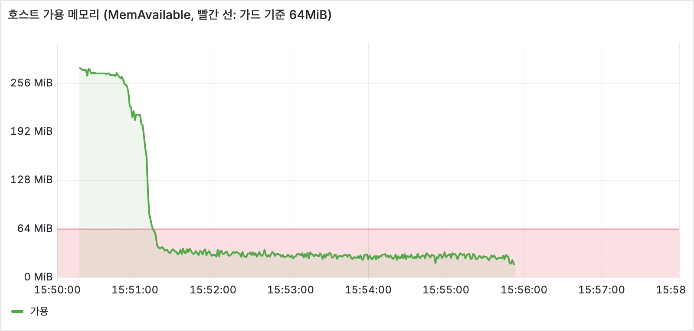
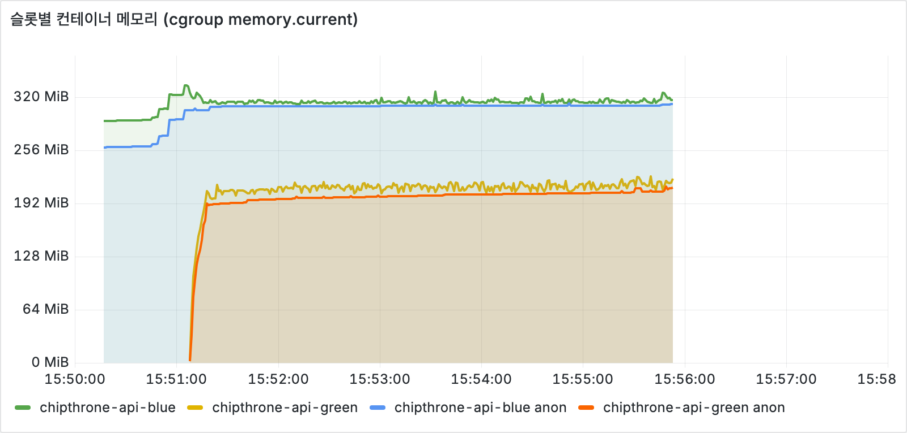
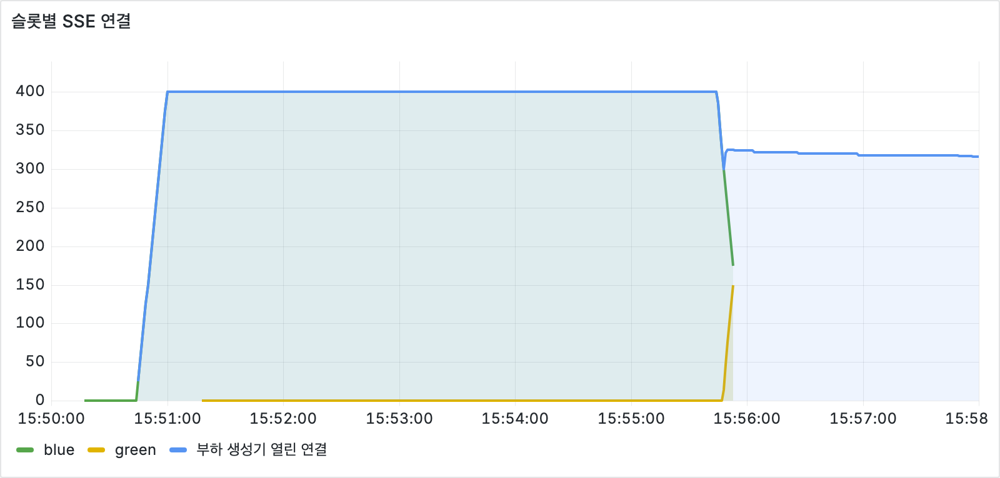
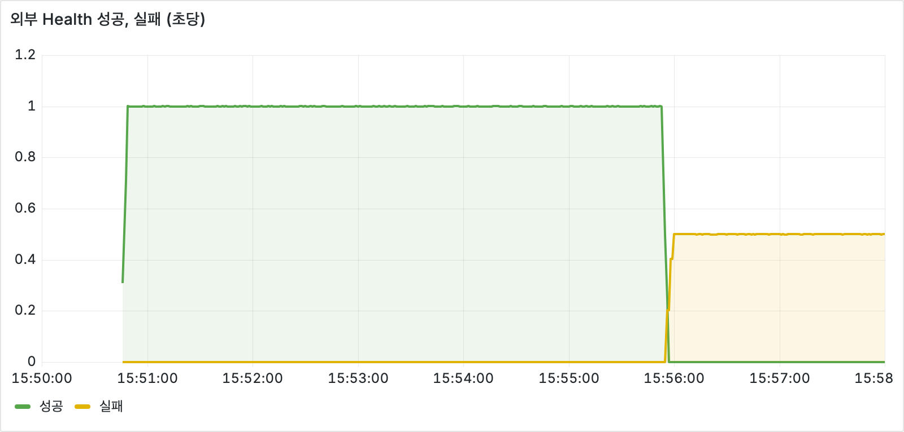
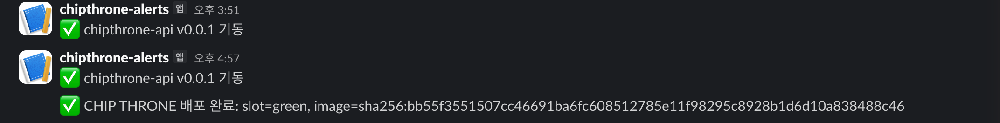
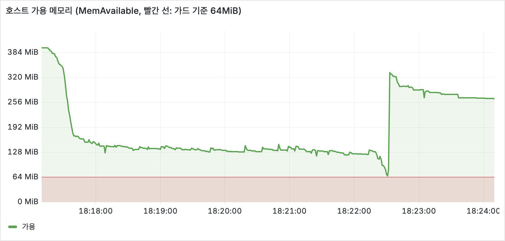
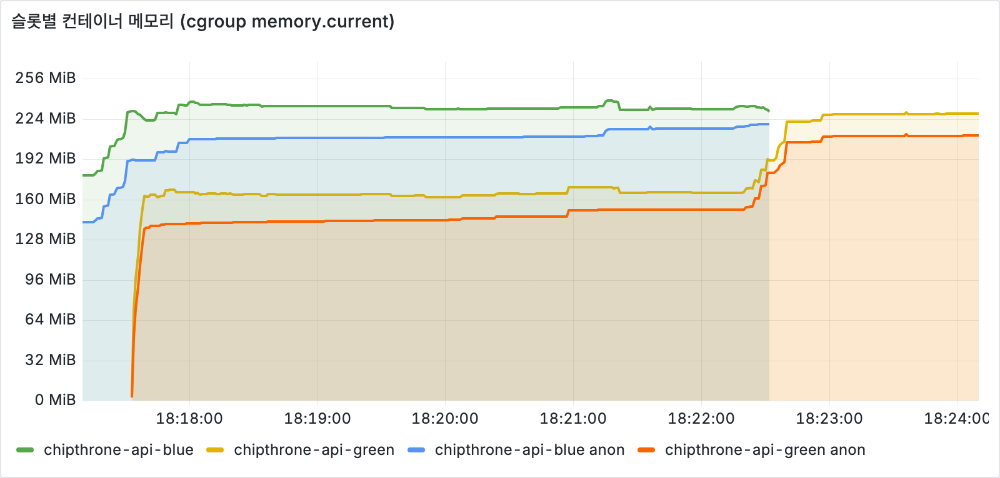
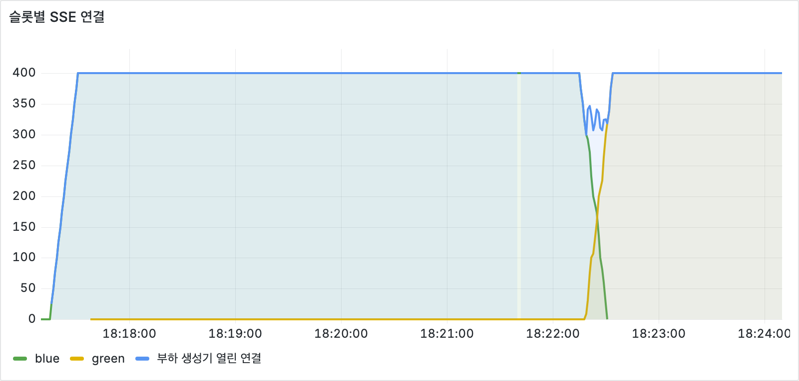
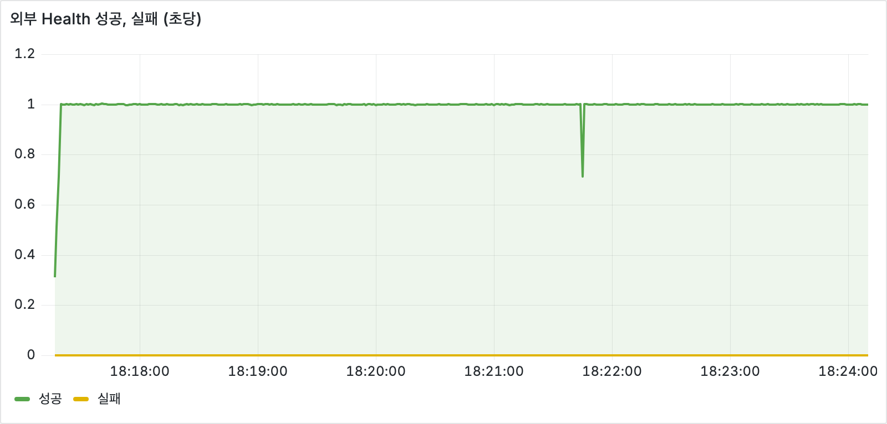
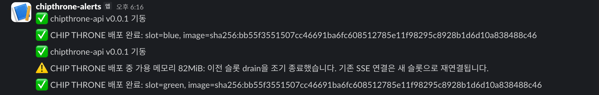

# 배포 중 두 슬롯 겹침과 t3.micro 메모리

## 검증 질문

슬롯 배포는 배포마다 JVM 두 개를 최대 310초 겹쳐 띄운다. 9월 2일 운영 전환 때 합성 요청만으로 최소 가용 메모리가 100MiB였고 swap은 없다. 실제 사용자 SSE 연결이 붙어 있는 상태에서 배포하면 무슨 일이 생기는가?

## 측정 장치

- 운영 EC2 t3.micro(916MiB, swap 0, 2 vCPU)를 그대로 사용했다. 새 AWS 리소스는 만들지 않았다.
- `loadtest/deploy_memory_exporter.py`: EC2에서 `/proc/meminfo`, 슬롯별 cgroup `memory.current`와 `memory.stat anon`, Nginx RSS, `/proc/vmstat`의 `oom_kill`을 Prometheus 형식으로 노출한다. 표준 라이브러리만 쓰고 Docker CLI를 호출하지 않는다. exporter 자체 RSS는 18.9MiB였다.
- `loadtest/run_deploy_memory_test.py`: 로컬 Mac에서 `https://api.chipthrone.com/api/stream`에 SSE 연결 N개를 유지한다. 브라우저 EventSource처럼 끊기면 3초 뒤 다시 연결하고, 매초 `/api/health`를 2초 제한으로 확인한다.
- SSH 터널로 exporter와 두 슬롯의 Actuator를 로컬 Prometheus(1초 수집)에 연결하고 `docker-compose.deploy-memory.yml`의 Grafana로 본다.
- 배포는 운영과 같은 스크립트를 `CHIPTHRONE_FORCE_DEPLOY=1`로 실행해 같은 이미지를 반대 슬롯에 올렸다.

```bash
docker compose -f docker-compose.deploy-memory.yml up -d
ssh -N -L 19101:127.0.0.1:9101 -L 28080:127.0.0.1:18080 -L 28081:127.0.0.1:18081 ec2-user@<EC2>
python3 loadtest/run_deploy_memory_test.py --connections 400 --duration 600 --output docs/deploy-memory/run.json
# http://localhost:13002/d/chipthrone-deploy-memory
```

## 1차: 기존 설정, SSE 400개 (2026-09-27 06:50 UTC)



| 시각 (UTC) | 사건 | 가용 메모리 |
|---|---|---:|
| 06:51:00 | 배포 직전, blue가 SSE 400개 처리 | 208MiB |
| 06:51:05 | green 후보 기동 | |
| 06:51:20 | green 기동 중 | 39MiB |
| 06:51:3x | Nginx green 전환, drain 시작 | 25~37MiB 유지 |
| 06:55:45 | blue SSE가 300초 수명으로 만료, green으로 재연결 시작 | 25MiB |
| 06:55:50 | | 18MiB |
| 06:55:54 | 외부 Health 첫 실패, 이후 SSH도 배너 교환 timeout | 수집 중단 |
| 07:34:09 | sshd `beginning MaxStartups throttling` | |
| 07:56:39 | 커널 OOM killer 발동, blue java 종료 (anon-rss 317,552kB) | |
| 07:56:4x | 밀려 있던 timer 실행, 서비스 복구 | |





서버는 06:55:54부터 07:56:39까지 약 61분 동안 외부 요청, SSH, 로그 수집 모두에 응답하지 못했다. 그동안 EC2 상태 검사는 3/3 통과였다. 부하 생성기는 Health 153회 연속 실패, 연결 timeout 2,004회를 기록했다.

### 왜 OOM killer가 바로 동작하지 않았나

sysstat가 10분마다 남긴 기록에서 06:50~07:56 구간은 샘플 하나로 뭉쳐 있다(그 사이 수집 자체가 실행되지 못했다). 원본은 [run1-sysstat.txt](deploy-memory/run1-sysstat.txt).

| 지표 | 06:40 평상시 | 06:50~07:56 평균 |
|---|---:|---:|
| `majflt/s` | 0.70 | 1,048.46 |
| `pgpgin/s` (KB/s) | 91.89 | 120,282.40 |
| `pgscank/s` + `pgscand/s` | 42 | 약 4,078,000 |
| `%vmeff` | 145.20 | 1.48 |
| `ldavg-1` | 0.01 | 84.43 |
| `kbcached` | 317,880 | 109,688 |

swap이 없어서 anonymous 메모리(JVM heap 등)는 내보낼 곳이 없다. 커널이 회수할 수 있는 것은 파일 페이지뿐이고, 여기에는 java, sshd, dockerd의 실행 코드도 포함된다. 코드 페이지를 버리면 곧바로 major fault로 다시 읽어 오는 일이 초당 1천 번 이상 반복됐다. 회수가 조금씩은 계속 "진전"하므로 커널은 OOM 상황으로 판단하지 않았고, 61분 뒤에야 OOM killer가 실행됐다.

배포 스크립트는 이 구간 동안 거의 실행되지 못했다. OOM kill 이후 남은 Readiness 확인이 통과하자 `deployment completed`로 끝났다. 61분 장애가 있었는데 배포는 성공으로 기록됐다.



## JVM 한 개가 왜 300MiB인가

`-XX:NativeMemoryTracking=summary`로 슬롯 하나에 SSE 400개를 붙이고 `jcmd VM.native_memory`로 확인했다. JRE 이미지에 `jcmd`가 없어서 `eclipse-temurin:21-jdk`를 `--pid container:<slot>`으로 붙였다.

| 영역 | 기존 `-Xms128m -Xmx320m` | 조정 후 |
|---|---:|---:|
| NMT committed 합계 | 254MB | 206MB |
| Java Heap committed | 128MB | 105MB |
| Metaspace | 47MB | 41MB |
| Code | 28MB | 15MB |
| Compiler arena peak | 36MB | 9MB |
| Arena Chunk peak | 37MB | 12MB |
| 프로세스 RSS | 275MiB | 226MiB |

- `-Xms128m` 때문에 heap은 사용량과 무관하게 128MB 아래로 줄지 않는다.
- C2 컴파일이 몰리는 기동 직후 compiler arena가 36MB까지 올라간다. 해제 뒤에도 glibc가 돌려주지 않은 만큼 RSS에 남는다. 새 슬롯의 기동이 가용 메모리를 208MiB에서 39MiB로 끌어내린 주 원인이다.

조정한 옵션: `-Xms64m -Xmx320m -XX:TieredStopAtLevel=1 -XX:ReservedCodeCacheSize=32m -Xss512k`

C2를 끄면 CPU 효율이 나빠질 수 있어서 같은 SSE 400개 4분 구간을 비교했다.

| 항목 | 기존 | 조정 후 |
|---|---:|---:|
| 컨테이너 CPU (코어) | 0.046 | 0.038 |
| SSE 전달 지연 p95 | 57ms | 61ms |
| 후보 Ready까지 | 약 30초 | 7초 |
| 후보 기동 직후 `memory.current` 최대 | 약 210MiB | 174MiB |

이 서비스는 3초마다 작은 JSON을 fan-out하는 I/O 중심 워크로드라 C2의 이점이 드러나지 않았다. 원본은 [nmt-tuned-400.txt](deploy-memory/nmt-tuned-400.txt), [nmt-single-slot-400.json](deploy-memory/nmt-single-slot-400.json), [nmt-single-slot-400-tuned.json](deploy-memory/nmt-single-slot-400-tuned.json).

## 선택지

- **t3.small로 업그레이드**: 메모리 2배로 문제는 사라지지만 월 비용도 2배다. 트래픽이 아니라 배포 순간 10분 남짓 때문에 상시 비용을 두 배로 내는 셈이라 제외.
- **swap 추가**: 멈춤이 "느려짐"으로 바뀔 뿐이다. Serial GC가 swap된 heap을 훑으면 멈춤 시간이 커지고, 언제 느려지는지 예측할 수 없다. 원인(두 JVM이 안 들어감)은 그대로라 제외.
- **컨테이너 `--memory` 제한**: 호스트 대신 컨테이너가 OOM kill된다. 그런데 drain 중 제한에 먼저 닿는 쪽은 연결이 몰리는 새 슬롯이라, 새 슬롯이 죽고 재시작하는 루프가 된다. 제외.
- **JVM 상주 메모리 축소 + 배포 스크립트 메모리 가드**: 채택. 축소로 평소 배포는 끝까지 drain하고, 그래도 바닥에 닿는 순간에는 멈춤 대신 재연결을 택한다.

## 메모리 가드

`infra/deploy-backend.sh`

- 기동 전: 가용 메모리가 `MIN_AVAILABLE_MIB(64) + CANDIDATE_RESERVE_MIB(180)`보다 작으면 후보를 띄우지 않고 미룬다. 같은 이미지에 대한 Slack 알림은 한 번만 보낸다(timer가 60초마다 다시 시도).
- 후보 기동 중: 가용 메모리가 64MiB 아래로 내려가면 후보를 지우고 기존 슬롯을 유지한다. 실패 이미지로 기록하지 않는다.
- drain 중: 가용 메모리가 64MiB 아래로 내려가면 이전 슬롯을 `docker rm -f`로 즉시 제거한다. 이전 슬롯의 SSE는 끊기고 새 슬롯으로 재연결되며, 이후 자동 롤백 대상이 사라진다. graceful stop을 기다리지 않는 이유는 1차 실험에서 18MiB에서 수 초 만에 멈췄기 때문이다.

`infra/deploy-backend.test.sh`에 세 경로(기동 전 부족, 기동 중 부족, drain 중 부족)를 추가했다.

## 2차: JVM 조정 + 가드, SSE 400개 (09:17 UTC)






| 시각 (UTC) | 사건 | 가용 메모리 |
|---|---|---:|
| 09:17:30 | 배포 직전, blue가 SSE 400개 처리 | 323MiB |
| 09:17:38 | green Ready, 전환 (기동 7초) | |
| 09:17:38~09:22:10 | drain | 최저 118MiB |
| 09:22:14~09:22:30 | blue SSE 400개가 300초 수명으로 만료, green으로 재연결 | 133MiB에서 67MiB로 하락 (1초 수집 기준) |
| 09:22:31 | 가드: 64MiB 미만 감지, blue 제거 | |
| 09:22:33 | | 332MiB |
| 09:22:53 | 배포 완료 | |

| 항목 | 1차 | 2차 |
|---|---:|---:|
| 외부 Health 실패 | 153회 (61분 멈춤) | 0회 |
| Health 최대 응답시간 | 2,001ms (timeout) | 209ms |
| SSE 재연결 | 2,243회 | 400회 |
| 연결 timeout | 2,004회 | 0회 |
| OOM kill | 1회 | 0회 |



알림의 82MiB는 64MiB 미만을 감지한 뒤 이전 슬롯을 제거하기 직전에 다시 읽은 값이다.

2차의 재연결 400회는 가드 때문이 아니라 SSE 300초 수명 만료로 원래 일어나는 재연결이다. 연결이 모두 green으로 옮겨 간 직후, 연결 0개인 blue가 메모리를 쥔 채 남아 있는 동안 가용 메모리가 64MiB 아래로 내려갔고 가드가 blue를 drain 종료(09:22:48)보다 17초 먼저 제거했다. 효과를 나누면 다음과 같다.

- 전환부터 재연결 직전까지의 여유(최저 25MiB에서 118MiB): JVM 조정
- 재연결이 몰린 순간 바닥에 닿지 않게 한 것: 가드

가드가 없었다면 2차가 멈췄을지는 이 실험으로 알 수 없다. 1차에서 멈춤이 시작된 18MiB까지 내려가지 않았기 때문이다.

## 발견한 것

- AWS 상태 검사는 이 멈춤을 감지하지 못했다(3/3 통과). 하이퍼바이저에서 보면 인스턴스는 살아 있다.
- 배포 스크립트가 61분 장애 뒤에 성공을 보고했다. Readiness를 2초마다 확인하는 구조는 스크립트 자신이 실행되지 못하는 상황을 전제하지 않는다.
- 부하가 끝난 뒤에도 JVM은 메모리를 돌려주지 않았다. SSE 400개를 한 번 받은 슬롯은 연결이 0이 되어도 280~300MiB를 유지해, 부하가 지나간 뒤의 배포도 가드에 의해 보류될 수 있다.

## 한계

- 부하 생성기는 한 곳(로컬 Mac)에서 연결을 연다. 실제 사용자 분포, 모바일 네트워크, 브라우저별 재연결 간격은 반영하지 않았다.
- 1차와 2차는 JVM 옵션과 가드를 함께 바꿨다. 두 변경을 따로 떼어 같은 부하로 측정하지 않았다.
- 64MiB 기준은 1차에서 멈춤이 시작된 약 18~25MiB에 여유를 둔 값이다. 연결 수가 크게 늘면 재연결 폭주 속도가 가드 확인 간격(2초)보다 빠를 수 있다.
- 조정한 옵션의 CPU와 지연 비교는 4분 구간 한 번씩이다.
- 가드가 drain을 조기 종료하면 그 배포는 자동 롤백을 할 수 없다.
